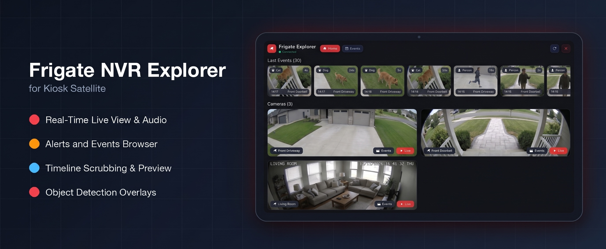
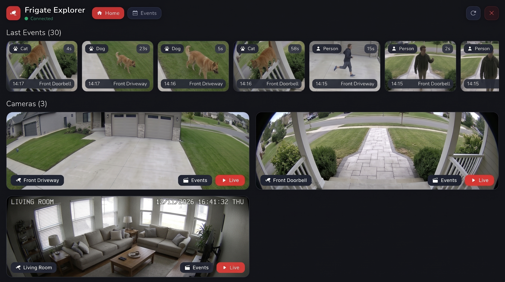
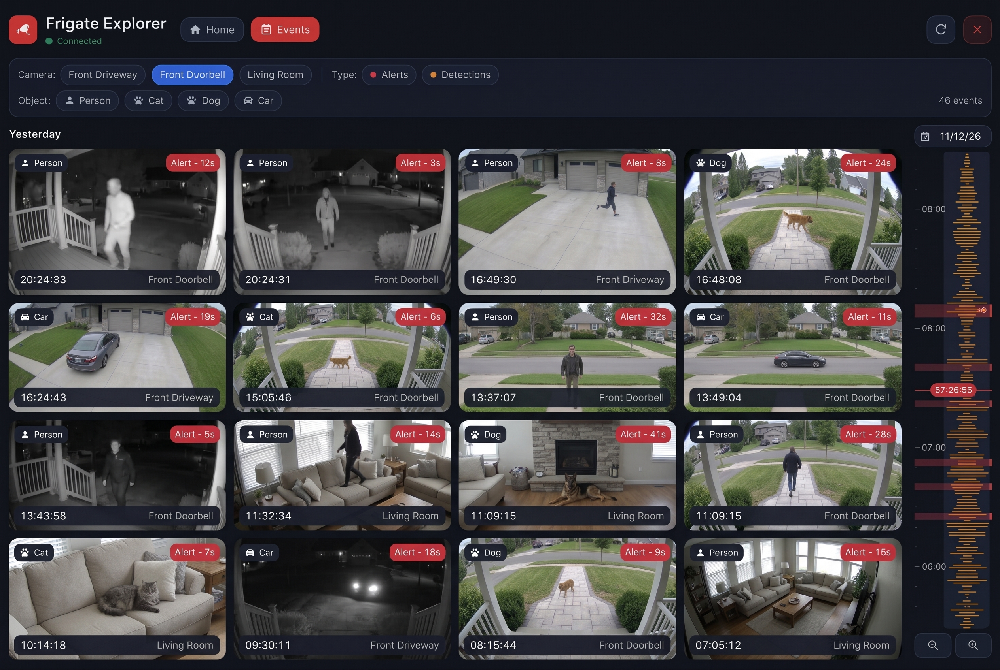
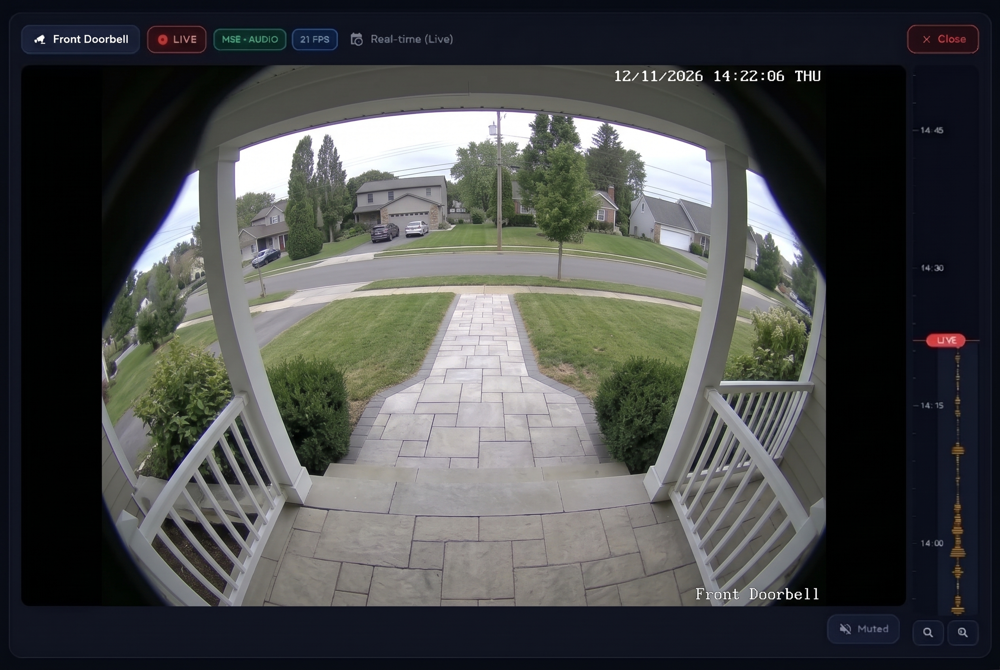
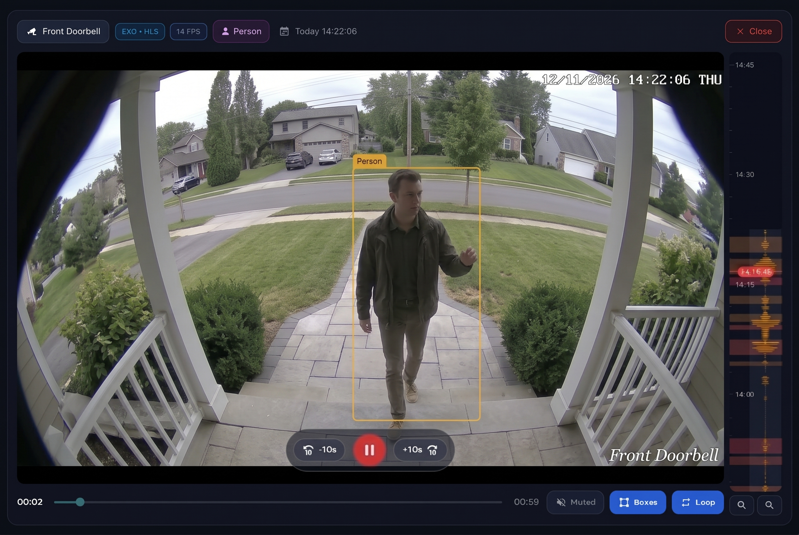

# Frigate NVR Explorer for Kiosk Satellite

Native Frigate NVR camera viewer with live streams, events & reviews browser, clip playback with detection boxes, and recording timeline scrubbing for [Kiosk Satellite](https://github.com/jxlarrea/kiosk-satellite).



---

## Features

- **Native Android UI**: Designed for Kiosk Satellite with configurable UI scaling for wall-mounted tablets.
- **Cameras & Real-Time Live View**:
  - Camera grid with live snapshots and one-tap live player launch.
  - Real-time live video/audio playback.
  - Live detected object pills refreshed in real time in the player header.
- **Events & Reviews Browser**:
  - Browse recent Frigate detections, alerts, and review segments merged chronologically.
  - Filter by **type**, **camera**, **tracked object labels**, and **date**.
  - Synchronized vertical timeline panel with tap-to-jump and zoom controls.
- **Recorded Playback & Timeline Scrubbing**:
  - Native HLS player with hardware decoding and software fallback, plus clip and HD snapshot fallbacks.
  - Video overlay controls (`-10s`, Play/Pause, `+10s`), timeline seek bar, audio mute/unmute, loop toggle, and optional stream mode badge.
  - Toggleable interpolated **object bounding boxes** overlay over recorded events and timeline playback.
  - Full-height vertical Frigate-style timeline ruler with motion/activity waveform, pinch/button zoom, and real-time recording snapshot preview while scrubbing.
- **Localization (i18n)**:
  - Follows the tablet's default language and 12h/24h date/time format automatically.
  - Built-in **English** and **French** translations, with an optional manual language override in plugin settings.
- **Home Assistant & Kiosk Automation**:
  - Launch cameras or open/close the viewer from Home Assistant scripts, automations, or dashboard deep-links (`ks://plugin/kiosk-satellite-frigate/openCamera/<camera>`).

---

## Screenshots

| Home — Cameras & Last Events | Events & Reviews Browser |
| :---: | :---: |
|  |  |
| **Live Stream & Timeline** | **Event Playback & Object Bounding Boxes** |
|  |  |

---

## Installation

### Community Plugins (Recommended)

Frigate NVR Explorer is listed in [Community Plugins](https://kiosksatellite.com/plugins/). Use the button below to open it in your Kiosk Satellite and install it.

[](https://kiosksatellite.com/redirect/plugin/?repository=tibohlami/kiosk-satellite-plugin-frigate)

Or search for `Frigate NVR Explorer` in **Settings > Plugin Manager > Browse plugins** in Kiosk Satellite.

### Manual

1. Open **Settings > Plugin Manager** in Kiosk Satellite and turn on **Enable Plugins**.
2. Choose **Add plugin**, paste `https://github.com/tibohlami/kiosk-satellite-plugin-frigate` and choose **Preview**.
3. Review the plugin and choose **Trust and install**.

### Requirements
- **Kiosk Satellite** `2026.10.40` or newer (Android SDK 24+).
- **Frigate NVR** reachable over your local network (`port 5000` unauthenticated, or `port 8971` authenticated with HTTPS/login or Bearer JWT).

---

## Configuration

Open **Settings > Plugin Manager > Frigate NVR Explorer > Settings** in Kiosk Satellite:

> [!TIP]
> **Auto-Detection**: On first start, the plugin automatically tries to detect your Frigate server URL via your Home Assistant connection and local network (`frigate.local`). You only need to configure it manually if auto-detection does not find your instance or if authentication is required.

### Connection
| Setting | Key | Default | Description |
| :--- | :--- | :--- | :--- |
| **Frigate Server URL** | `frigateUrl` | `http://frigate.local:5000` | Base HTTP or HTTPS URL of your Frigate NVR instance. |
| **Frigate Username** | `username` | *(empty)* | Optional username for authenticated Frigate instances (e.g. port `8971`). |
| **Frigate Password** | `password` | *(empty)* | Optional password used with `username` for `/api/login` session authentication. |
| **Bearer Token / JWT** | `authToken` | *(empty)* | Optional manual Bearer token override (leave empty when using username/password or unauthenticated port `5000`). |
| **Accept untrusted SSL certificates** | `allowInsecureSsl` | `false` | Allows self-signed or untrusted local HTTPS/WSS certificates (use only on trusted local networks). |
| **Test connection** *(button)* | `testConnection` | — | Verifies URL reachability, TLS validation, authentication, and `/api/config` camera access. |

### Interface
| Setting | Key | Default | Description |
| :--- | :--- | :--- | :--- |
| **Language** | `language` | `Default` | UI language (`Default` uses the tablet's default locale). |
| **UI Scale Factor** | `uiScaleFactor` | `1.35` | Interface scaling factor (`0.5`–`3.0`, step `0.05`) for wall-mounted tablets. |
| **Show stream transport badge** | `showStreamModePill` | `true` | Displays the active transport badge (`MSE`, `MJPEG`, `EXO`, `HLS`, `MP4`, `PREVIEW`) in the player header. |
| **Show object bounding boxes by default** | `showObjectBoxesByDefault` | `false` | Enables object detection bounding boxes automatically in event and history playback. |
| **Object box time offset (s)** | `bboxTimeOffsetSec` | `1.0` | Time shift in seconds (`-5.0` to `+5.0`, step `0.25`) to align bounding boxes with recorded video (typically `+1.0` to `+2.5` s depending on camera GOP and stream latency). |
| **Mute audio by default** | `muteAudioByDefault` | `false` | Starts live streams and recorded clips muted when opening the player. |
| **Frigate Explorer** *(button)* | `openExplorer` | — | Opens the Frigate Explorer panel on the kiosk. |

---

## Home Assistant Integration

### Plugin Commands
- `showExplorer`: Opens the Frigate cameras & events browser overlay.
- `hideExplorer`: Closes the Frigate browser overlay.
- `openCamera`: Opens a live camera stream overlay (`camera` argument or first item in `args`; falls back to the first discovered camera).
- `hidePlayer`: Closes the active camera/event player overlay.

### Published Entities
- `frigate_status` *(text sensor)*: Connection status (`Connected` / `Error`).
- `cameras` *(text sensor)*: Count and list of discovered Frigate cameras.
- `active_camera` *(select)*: Switch the live camera overlay directly from Home Assistant (`Closed` or any discovered camera name).
- `cam_<camera_name>` *(text sensors)*: Dashboard shortcut URIs (`ks://plugin/kiosk-satellite-frigate/openCamera/<camera>`) for each camera (up to 29 cameras).

---

## Privacy & Data Handling

- **Direct Local Communication Only**: All network requests (Frigate REST API calls, thumbnails, snapshots, HLS VOD segments, MP4 clips, and go2rtc WebSocket streams) are sent **exclusively** to the Frigate Server URL you configure in settings.
- **No External Telemetry or Third-Party Servers**: This plugin does not collect analytics, telemetry, or diagnostics and does not transmit data to any external service.
- **Local Storage & Cache**: Configuration values (including credentials/tokens) are stored inside Kiosk Satellite's plugin settings store. Temporary fallback MP4 clip downloads are stored strictly inside Kiosk Satellite's private cache directory (`frigate_clips_cache`, automatically pruned to the most recent files).

---

## Building from Source

Requires Python 3, JDK 8+ (or JDK 17), and an Android SDK installation (`ANDROID_HOME` or `ANDROID_SDK_ROOT` pointing to an SDK with `platforms/` and `build-tools/`):

```bash
python3 package_plugin.py
```

This compiles the Kiosk Satellite SDK stubs and plugin sources, shades Media3 dependencies, converts classes to Android DEX (`plugin.jar`), bundles `kiosk-satellite-plugin.json`, `LICENSE`, and `assets/` into `dist/kiosk-satellite-frigate-<version>.zip`, and writes `dist/kiosk-satellite-frigate-<version>.zip.sha256` and `dist/kiosk-satellite-plugin.json`.

---

## License

Licensed under the [Apache License, Version 2.0](LICENSE).
See [NOTICE](NOTICE) for third-party open-source attributions, UI design inspirations, and non-affiliation notice.
